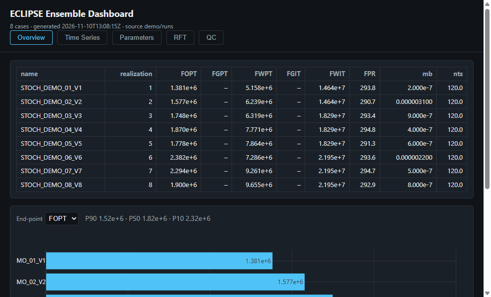
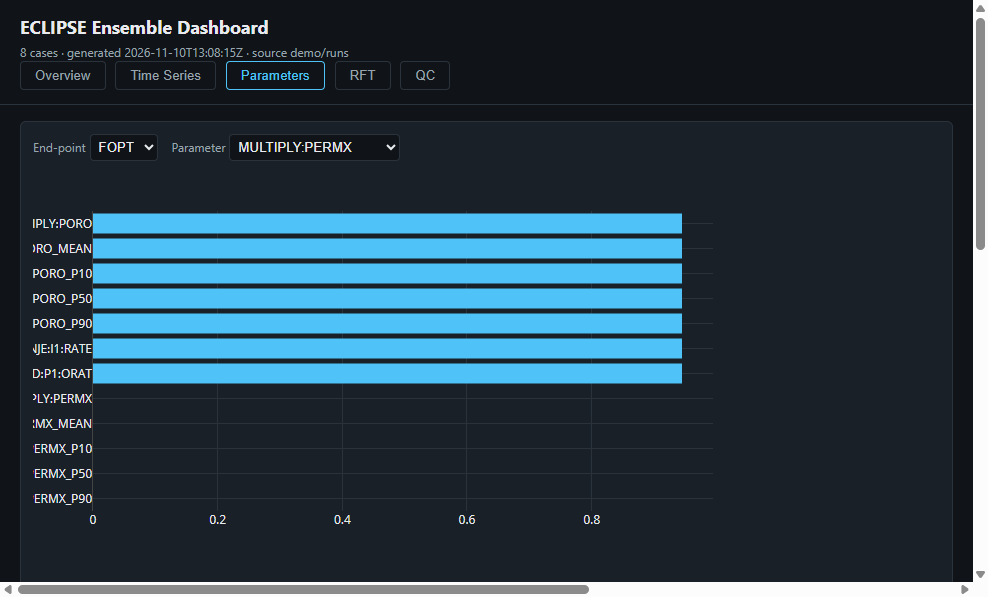
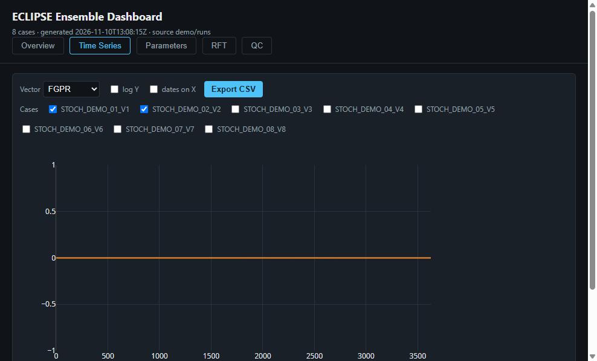
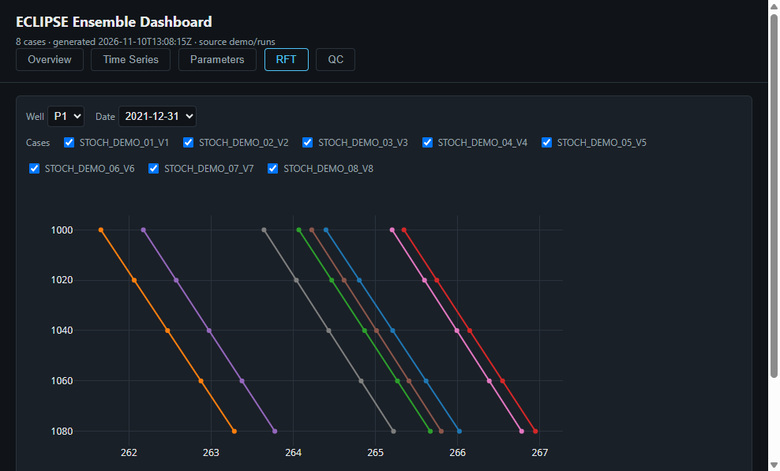

# ECLIPSE Ensemble Dashboard

Turn a folder of ECLIPSE simulation runs (e.g. stochastic realizations) into **one self-contained
HTML dashboard** — double-click to open on any Windows PC, no Python, no internet required at
viewing time. Optional Streamlit mode for live re-extraction.



## Try the demo in 10 seconds

1. Download this repository (green **Code** → **Download ZIP**) and unzip it.
2. Double-click **`demo_dashboard.html`**.
3. That's it — 8 synthetic stochastic realizations with all five tabs working offline.

## Build a dashboard from your own runs

Prerequisites (only on the PC you build from): Windows 10/11, Python 3.10+ with the
`py` launcher, then:

```bat
run_dashboard.bat C:\path\to\your\eclipse\runs
```

The launcher installs dependencies on first run (`pip install -r requirements.txt`),
extracts every case it finds, builds `dashboard.html` next to the script and opens it.
Your ECLIPSE files are read locally — nothing leaves your PC.

Command line equivalent:

```bat
python build_dashboard.py C:\path\to\runs -o dashboard.html
```

| Option | Meaning |
|---|---|
| `-o FILE` | output HTML (default `dashboard.html`) |
| `--bundle-json FILE` | rebuild HTML from a saved bundle instead of re-extracting |
| `--max-points N` | thin time series beyond N points (default 4000, min/max preserving) |
| `--realization-regex RE` | custom regex to pull the realization ID from case names |

**What counts as a case?** Any `.SMSPEC` + `.UNSMRY` pair found recursively under the folder
you point at. Sibling `.RFT`, `.PRT` and `.DATA` files with the same base name are picked up
automatically. Realization IDs are parsed from names like `..._V2` or folders like `REAL-03`.

## Streamlit mode (optional)

```bat
pip install -r requirements.txt
streamlit run app.py
```

Then point the sidebar at a `bundle.json` or a runs folder. Same five views, live from disk.

## The five tabs

| Tab | What you get |
|---|---|
| **Overview** | Case table (FOPT/FGPT/FWPT/FWIT/FGIT/FPR end-points, QC flags) + end-point ranking with P10/P50/P90 |
| **Time Series** | Any summary vector × any cases, log scale, dates or days, CSV export |
| **Parameters** | Per-case input parameters (MULTIPLY, well controls, GRDECL property stats) + Spearman tornado vs a chosen end-point + scatter |
| **RFT** | Pressure vs depth per well × survey date, multi-case overlay |
| **QC** | Material-balance error, timestep counts, CPU time, FIP volumes per region |





Missing files degrade gracefully — a case without `.RFT` simply shows no RFT surveys.

## Data privacy

The repository ships **only synthetic demo data** (generated by `demo/make_demo.py`).
`.gitignore` blocks all ECLIPSE output extensions, so real simulation data and the dashboards
built from it cannot be committed accidentally.

## Development

```bat
pip install -r requirements.txt
python -m pytest tests -q          # 19 tests
python demo/make_demo.py           # regenerate the demo ensemble
python build_dashboard.py demo/runs -o demo_dashboard.html
```

Built on [resdata](https://github.com/equinor/resdata) (ECLIPSE file IO),
[resfo](https://github.com/equinor/resfo), [Plotly](https://plotly.com/python/) and
[Streamlit](https://streamlit.io). MIT licensed — see `LICENSE`.
